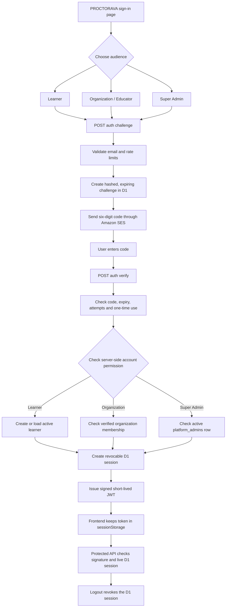
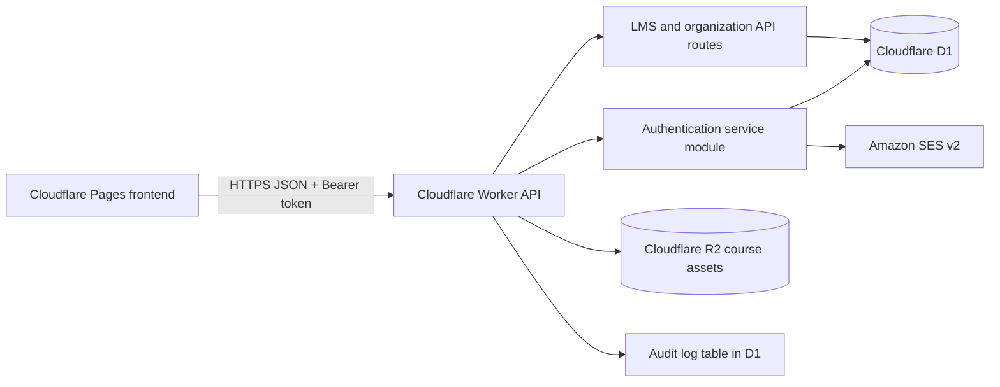

# PROCTORAVA Authentication Architecture

## Purpose and current release boundary

This document is the source of truth for the three PROCTORAVA sign-in paths. It is written so a new engineer or agent can continue without relying on previous chat history.

The implementation adds passwordless email one-time-code authentication to the existing Cloudflare Worker API. It does not create passwords, expose OTP values to the browser, or trust a role selected in the browser.

**Important release boundary:** the code and database migration are prepared in this branch. The production D1 database, Worker deployment, AWS SES credentials/sender verification, and end-to-end production tests still need to be provisioned. The frontend's API address is a planned Worker address and must not be described as live until the deployment is verified.

## Sign-in choices and role boundaries

| Entry page | Audience | Verification | Backend authorization |
|---|---|---|---|
| Learner | Students, applicants and individual learners | Email OTP | Active learner account; new learner account is created only after a valid code |
| Organization / Educator | Verified schools, companies and publishers; their owners, administrators, publishers, instructors and reviewers | Email OTP | Active membership in a verified organization; verified owner email may claim the owner role |
| Super Admin | Platform administrators only | Email OTP | Existing active row in the private `platform_admins` table; never granted by a request parameter |

All three pages use the same service and code-verification process. The audience is stored on the server-side challenge and cannot be changed during verification.

Organization login returns all verified organizations where the person has active membership. The user must still be authorized for each requested organization and course by the existing API role checks.

Super Admin sessions are shorter (4 hours) than learner and organization sessions (12 hours). This implementation has an administrator allow-list, but does not yet implement a second independent MFA factor such as WebAuthn or TOTP. Treat a second factor as a mandatory security improvement before granting broad production administration access.

## Sign-in flow



## Component architecture



The Worker and frontend are separate deployments. The browser never receives AWS credentials, OTP signing secrets or JWT signing secrets.

## API contract

Base URL is the deployed Worker origin followed by `/api`. The frontend currently expects the planned Worker origin in `AUTH_API_BASE`; update it if the actual Worker hostname changes.

### 1. Request a code

`POST /api/auth/challenge`

Request:

```json
{
  "email": "person@example.com",
  "audience": "learner"
}
```

Allowed `audience` values: `learner`, `organization`, `admin`. An optional `organizationId` may be sent by a future organization selector.

Success (202):

```json
{
  "ok": true,
  "challengeId": "server-generated-id",
  "expiresInSeconds": 600,
  "resendAfterSeconds": 60,
  "message": "If this address can use this sign-in option, a verification code has been sent."
}
```

The response intentionally does not disclose whether an email has learner, organization or administrator access. The code itself is sent only by SES.

### 2. Verify a code

`POST /api/auth/verify`

Request:

```json
{
  "email": "person@example.com",
  "challengeId": "id-from-challenge-response",
  "code": "123456"
}
```

Success includes a short-lived bearer token, expiry, the verified account, its server-determined role and available organization memberships. Do not accept a role from the browser as proof of permission.

### 3. Read the current account

`GET /api/auth/me`

Requires `Authorization: Bearer <token>`. Returns the account, whether the private platform-admin allow-list grants administrator status, verified organization memberships, and the sign-in audience.

### 4. Sign out

`POST /api/auth/logout`

Requires the bearer token. Revokes its session row in D1. The API rejects that token on subsequent requests.

## OTP and session controls

- Six numeric digits, generated using the platform cryptographic random generator.
- Ten-minute expiry.
- One successful use only.
- Maximum five verification attempts for one challenge.
- At least 60 seconds between code requests for the same email.
- Maximum five code requests per email in a rolling 15-minute window.
- Maximum twenty code requests per source IP in a rolling 15-minute window.
- OTP values are never stored. D1 stores a keyed HMAC of the code, challenge ID and keyed email hash.
- Email and source IP values are not stored in the challenge table in clear text; keyed hashes are used for rate-limit matching.
- Expired challenges and old/revoked sessions are cleaned during challenge requests.
- Learner and organization session lifetime: 12 hours.
- Super Admin session lifetime: 4 hours.
- JWTs are signed with HS256 and include issuer, audience, issued-at, expiry, session ID (`jti`) and login audience.
- Every API request using one of these JWTs checks that the corresponding D1 session still exists, has the same user and audience, has not been revoked and has not expired.
- The browser stores the bearer token in `sessionStorage`, not `localStorage`. Do not add token values to logs, URLs, analytics or error reports.

## Email delivery

The authentication module calls the Amazon SES v2 HTTPS endpoint and signs the request using AWS Signature Version 4. Default region is `ap-southeast-2`; production must set it explicitly. The sender must be a verified SES identity with production sending enabled.

Required private Worker secrets:
- `AWS_ACCESS_KEY_ID`
- `AWS_SECRET_ACCESS_KEY`
- optional `AWS_SESSION_TOKEN` if temporary credentials are used
- `AUTH_OTP_SECRET` (at least 32 characters; use a cryptographically random secret)
- `AUTH_JWT_SECRET` (at least 32 characters; use a different cryptographically random secret)

Required Worker variables:
- `AWS_REGION=ap-southeast-2`
- `SES_FROM_EMAIL` (must be verified in the selected SES region)
- `AUTH_ISSUER` (exact deployed API origin)
- `AUTH_AUDIENCE=proctorava`
- `APP_ORIGIN=https://proctorava.pages.dev`

Never put these secrets in HTML, JavaScript, GitHub files, README examples or a public Pages environment.

## Database changes

Migration: `worker/migrations/0004_auth_sessions.sql`

- `auth_challenges`: one-time code challenge metadata, keyed email/IP hashes, expiry, attempt count and consumed time.
- `auth_sessions`: user-bound, audience-bound, expiring and revocable session records.
- Indexes support email/IP rate-limit checks, session checks and expiry cleanup.

Existing user, organization, organization-member and platform-admin tables remain the source of role truth. Do not add a browser-managed role field.

## Error behavior

| Code | Meaning | Frontend behavior |
|---|---|---|
| `INVALID_SIGN_IN_DETAILS` | Invalid email or audience | Ask the person to correct the form |
| `TOO_MANY_REQUESTS` | Rate limit reached | Show a wait message; do not retry automatically |
| `EMAIL_NOT_CONFIGURED` / `EMAIL_DELIVERY_UNAVAILABLE` | SES is not ready or delivery failed | Show a safe retry-later message; never reveal provider credentials or raw SES errors |
| `CODE_INVALID_OR_EXPIRED` | Incorrect, expired or exhausted code | Offer a new code |
| `ORGANIZATION_ACCESS_REQUIRED` | No active verified organization membership | Direct the person to organization onboarding/support |
| `SUPER_ADMIN_REQUIRED` | Email is not on the active platform-admin allow-list | Do not offer account registration or role escalation |
| `AUTH_NOT_CONFIGURED` | Required secrets/issuer/audience are missing | Keep sign-in disabled and alert an operator |

## Security requirements

1. Keep `AUTH_JWT_SECRET` and `AUTH_OTP_SECRET` separate and rotate them under a documented incident procedure.
2. Use a dedicated AWS IAM principal restricted to SES send operations and the verified PROCTORAVA sender identity. Do not use an AWS administrator key.
3. Keep D1 and Worker environments separate for staging and production.
4. Restrict CORS to the exact production and staging origins.
5. Add Cloudflare edge rate limiting/WAF rules in addition to the D1 limits before public launch.
6. Keep the Super Admin bootstrap private. Never add a public route to insert into `platform_admins`.
7. Add independent MFA for Super Admin before enabling full production platform controls.
8. Never log OTP values, JWTs, email contents, AWS signatures or secret values.
9. Test cross-organization access denial and suspended-account denial.
10. Back up D1 before migrations and test restoration.

## Current limitations — do not misrepresent

- This branch contains the code and migration; it does not prove the production Worker or D1 database has been deployed.
- AWS SES credentials and a verified sender identity must be configured before OTP emails can be delivered.
- The current login pages do not yet render a Cloudflare Turnstile widget. Database rate limits are implemented; Cloudflare edge rate limits and bot protection remain production tasks.
- Super Admin has an allow-list and shorter session but no second independent MFA factor yet.
- SSO (SAML/OIDC), passkeys/WebAuthn, SMS/phone login, refresh tokens and self-service account recovery are not included.
- Organization and Super Admin dashboard screens are separate product work. This authentication API only provides secure identity and role context.
