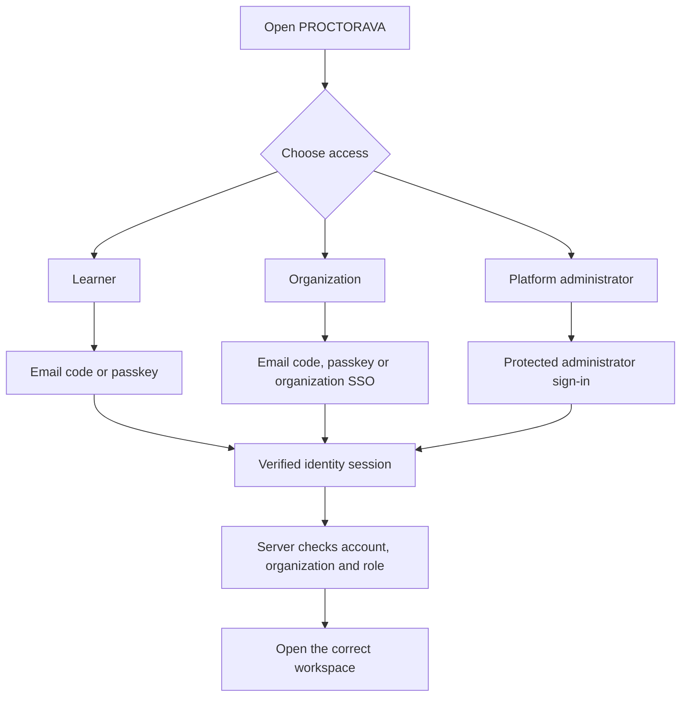

# PROCTORAVA experience and access review

## Work included in this update
- Replaced remaining visible **PROCTIFY** product labels with **PROCTORAVA** while keeping internal storage keys and service identifiers stable.
- Added responsive layouts for wide desktop monitors, laptops, tablets and phones.
- Added safe-area spacing, larger touch targets, visible keyboard focus, a skip link, reduced-motion support and better content wrapping.
- Kept image artwork and its captions in separate areas so text is not placed over cover images.
- Added an installable web-app manifest and a small offline shell cache.
- The offline cache deliberately excludes API requests and authenticated responses. It does not cache learner records, assessments, certificates or login data.
- Preserved the existing logo, favicon, assessment illustrations and typography.

## Repository audit findings that still require a connected identity service
The current site is an assessment-first static frontend. It is not yet a complete LMS portal. The Worker has organization, course, educator group and learner messaging endpoints, but the current HTML does not provide complete learner, educator, organization administrator and platform administrator workspaces wired to those endpoints.

The Worker currently accepts signed HS256 bearer tokens. It does not implement email one-time-code delivery, passkey registration/sign-in, an organization SSO protocol, or native mobile-app authentication. Those cannot be switched on safely by drawing login buttons in the browser.

## Required authentication behavior
- **Learners:** email one-time code and passkey sign-in.
- **Organization members:** the same options, plus their organisation's approved single sign-on connection.
- **Organization SSO:** use a verified organization domain and an approved OIDC or SAML identity provider. Require issuer, audience, signature, state, nonce and redirect URI checks; map users to the correct organization and role on the server.
- **Passkeys:** use WebAuthn with server-verified challenge, origin, relying-party ID, signature, credential ownership and counter checks. Never accept a browser-only "passkey success" flag.
- **Email one-time codes:** send through the configured email service; store only a protected hash, expire codes quickly, rate-limit requests and attempts, and invalidate a code after successful use.
- **App access:** the website can be installed as a PWA from a supported browser. Native iOS/Android application sign-in requires separate app builds and a secure app-to-API token flow.

## Before enabling production login
1. Select and connect the identity provider that will issue trusted user sessions and support passkeys, email codes and organisation SSO.
2. Configure email delivery and sender verification.
3. Add the provider's signing keys and exact issuer/audience values to Worker secrets/configuration.
4. Add organization-domain verification and SSO connection administration.
5. Add login, passkey, OTP, SSO callback, session revocation and account recovery tests.
6. Connect every role-specific workspace to the authenticated API and verify organization isolation.

## Review flow

## Deployment boundary
The Pages workflow publishes static files only. The Cloudflare Worker, D1 database, R2 storage, email sender and identity provider remain separate services. A successful static-site build does not mean authentication or LMS API services are live.

## Navigation tabs added
The main navigation is now grouped into clear areas:
- **Learn:** Home, Courses & assessments, My learning.
- **Credentials:** My certificates, Verify certificate.
- **Management:** Admin console.
- **Account:** Settings.

The links use existing application routes. The Admin console remains protected by the current server-backed admin token flow. Organization and educator workspaces are not shown as active navigation destinations yet: their API foundation exists, but their complete signed-in screens and identity services still need to be connected. This avoids presenting unfinished areas as working features.
