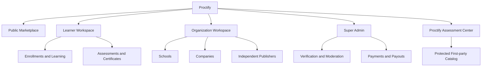

# Proctify LMS Architecture

## Product decisions
- Registration supports schools, companies and independent publishers.
- Proctify manages checkout, fees, refunds, transaction records and publisher payouts.
- Organizations may use fully branded portals and verified custom domains.
- Only verified organizations may publish public courses.
- Learners, organization users and platform administrators have separate sign-in experiences.
- Existing Proctify assessments and certifications remain first-party and protected.

## Platform areas
1. Public marketplace: courses, publishers, schools, instructors, categories and reviews.
2. Learner workspace: enrollments, course player, lesson progress, assignments, exams, assessment center, certificates and learning history.
3. Organization workspace: profile, branding, instructors, learners, course builder, publishing, assignments, analytics and revenue.
4. Super Admin workspace: organization verification, account moderation, first-party catalog, payments, payouts, settings and audit records.
5. Proctify Assessment Center: existing twelve assessment categories, scoring, proctoring and certification workflows.

## Ownership boundaries
| Content | Owner | Organization permissions |
|---|---|---|
| Existing assessment catalog, questions, scoring and certification rules | Proctify | Assign or purchase access only |
| School courses and materials | School | Manage its own content |
| Corporate training | Company | Manage its own content |
| Independent publisher courses | Publisher | Manage its own content |

Branding never transfers ownership. Every organization-owned record must be scoped to its organization on the server. First-party assessment records cannot be edited or deleted by organization users.

## Roles
- Learner: access enrolled or assigned learning.
- Owner: full control of one organization, including appointing administrators.
- Administrator: manage organization operations and members, but cannot appoint another administrator or change the owner.
- Publisher: create and publish courses for a verified organization.
- Instructor: manage assigned courses and learner progress only after an organization administrator assigns them to each course.
- Reviewer: review assigned course content and learner submissions only after an organization administrator assigns them to each course.
- Super Admin: platform-wide access, protected separately and audited.

Changing a URL or browser value must never grant a role. Authorization is checked by the API on every protected request. Public course detail URLs use globally unique slugs to avoid collisions between organizations.

## Publishing lifecycle
Draft → Published → Archived. A publisher must belong to a verified organization and have an active publisher-or-higher role. Public marketplace queries return only published courses from active, verified organizations, plus Proctify-owned first-party courses.

## Payment lifecycle
Checkout provider → signed webhook → idempotent payment event → order and order items → publisher ledger → refund/adjustment entries → payout approval → provider payout confirmation.

Never trust the browser to report payment success. Never store raw card data. Every webhook must be signature-checked and deduplicated by provider event ID. Refunds and payouts are ledger entries, not destructive edits.

## Additional safeguards
- Organization isolation and least-privilege roles.
- MFA for Super Admin and sensitive payout actions.
- Verified email before account activation.
- Turnstile and edge rate limits on public registration and login.
- Private course assets with signed, short-lived download links.
- Course version history and rollback.
- Assessment attempt integrity, proctoring consent, retention settings and incident review.
- Certificate verification codes, revocation and expiry.
- Accessible course player, captions/transcripts and keyboard navigation.
- Learner data export and account deletion workflow.
- Moderated reviews, abuse reports and content takedown process.
- Audit trail for verification, role changes, publishing, refunds, payouts and certificate revocation.
- Backups, restore drills, monitoring and incident response.

## Delivery boundary
The current GitHub Pages application is a static frontend. It does not provide a production database or secure server-side identity by itself. The Cloudflare Worker, D1 database, R2 bucket, identity issuer, SES delivery and payment provider must be provisioned and tested separately before the new services are considered live.

## Architecture

